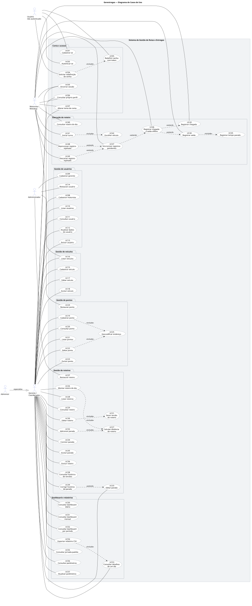
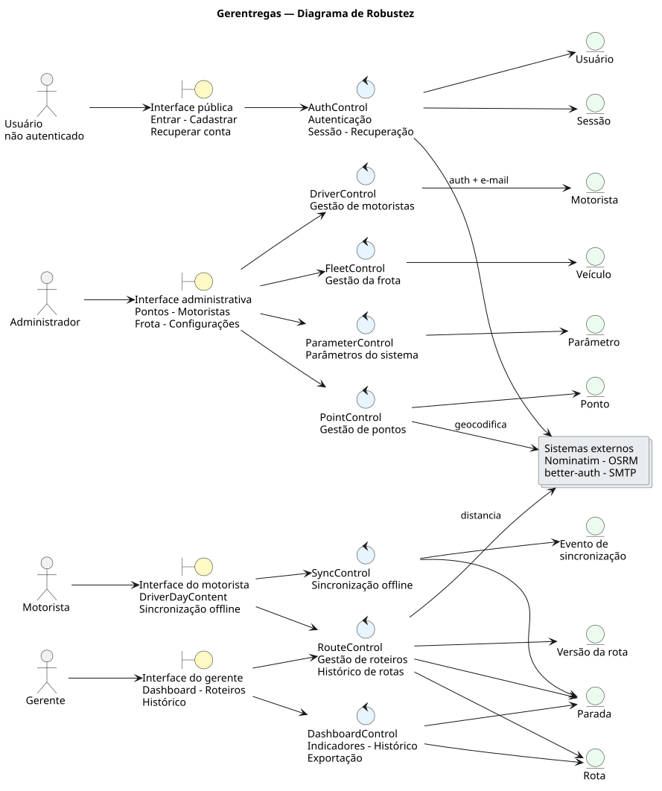
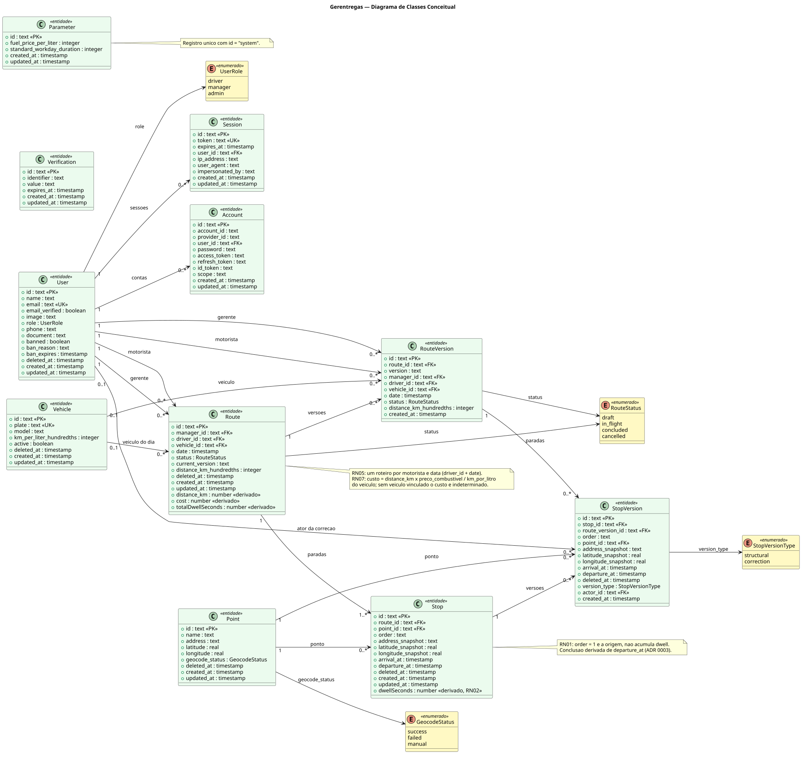

# Gerentregas

Sistema web de gestão de rotas de entrega que registra o **tempo parado** (*dwell time*) de profissionais de campo em cada ponto do roteiro diário, calcula o **custo estimado** do trajeto e apresenta indicadores em um *dashboard* por dia, mês e período.

> Projeto acadêmico (Engenharia de Software II — PUC). Especificação original em [`tarefa.md`](./docs/tarefa.md).

## Demonstração online

O projeto está rodando em **[https://gerentregas.vercel.app](https://gerentregas.vercel.app)**. Para explorar com acesso total, entre como administrador:

| Campo | Valor |
| --- | --- |
| E-mail | `admin@admin.com` |
| Senha | `123456` |

## O problema

Empresas de logística e entrega urbana precisam saber onde e por quanto tempo seus profissionais de campo ficam parados durante o roteiro diário. Hoje esse tempo é invisível: não há registro confiável de quanto tempo o entregador/motorista permanece em cada ponto, o que impede identificar gargalos, renegociar prazos e calcular o custo real de cada rota.

## Objetivo do MVP

- Identificar quanto tempo o motorista fica parado em cada ponto do roteiro diário.
- Registrar e persistir pontos, roteiros e tempos coletados.
- Apresentar *dashboard* com gráficos de tempo parado por dia, mês e período.
- Calcular indicadores de custo do trajeto (custo por km, consumo km/litro).

**Fora do escopo:** roteirização automática, integração com folha/ERP, telemetria embarcada em tempo real, app nativo publicado em loja.

## Funcionalidades

Resumo por área. A especificação completa — RF01–RF52, RNF01–RNF18 e RN01–RN09 — vive em [`docs/requisitos.md`](./docs/requisitos.md).

- **Conta e acesso:** cadastro, login, recuperação de senha, perfil e tema.
- **Usuários:** motoristas e gerentes (cadastro, listagem, arquivamento com bloqueio de acesso).
- **Frota:** veículos com placa, modelo e consumo (km/litro).
- **Pontos:** cadastro com geocodificação automática (Nominatim) ou coordenadas manuais.
- **Roteiros:** montagem diária, distância automática (OSRM), versionamento auditado, correção de horários.
- **Operação do motorista:** roteiro do dia, check-in/check-out, fila offline com sincronização.
- **Dashboard:** tempo parado por dia, mês e período, detalhamento diário e exportação CSV.
- **Parâmetros:** preço do combustível e jornada padrão, alteráveis sem mexer no código.

## Stack

| Camada | Tecnologia |
| --- | --- |
| Aplicação | Next.js 16 (App Router) + React 19 + TypeScript estrito |
| API | tRPC 11 (`/api/trpc`) + better-auth (`/api/auth/[...all]`) |
| Persistência | PostgreSQL 16 + Drizzle ORM + `pg` + `drizzle-kit` |
| Auth | better-auth (e-mail/senha, plugin `admin`, i18n pt) |
| Validação | Zod 4 |
| UI | Tailwind CSS 4, shadcn/Base UI, Recharts, Sonner, `next-themes`, Leaflet |
| Cliente | PWA instalável, fila offline em IndexedDB via Dexie |
| Integrações | Nominatim (geocodificação), OSRM (distância), SMTP/Nodemailer |
| Qualidade | Biome, Vitest 4, Husky + lint-staged + commitlint |
| Diagramas | PlantUML (`.puml` → `.svg` via Docker `plantuml/plantuml`) |

## Arquitetura

```
Router (tRPC) → Controller → Service → Repository → PostgreSQL
 (transporte)    (orquestra)   (regras)    (queries Drizzle)
```

Módulos em `src/server/modules` (`auth`, `dashboard`, `drivers`, `fleet`, `parameters`, `points`, `routes`, `sync`). Perfis: `driver` (`/motorista`), `manager` (`/admin`), `admin` (gerente + criar gerentes + restaurar tudo). Detalhes em `src/server/ARCHITECTURE.md`.

## Diagramas

Fontes PlantUML em [`docs/diagrams/puml/`](./docs/diagrams/puml/). O [`docs/diagramas.md`](./docs/diagramas.md) mantém as versões Mermaid com o mapeamento requisito → código.

### Casos de uso (57 UCs, 4 atores)



### Robustez (ator → boundary → control → entity)



### Classes conceitual (11 entidades + 4 enums)



Para regenerar os SVGs:

```bash
docker run --rm -v "$PWD":/data plantuml/plantuml:latest \
  -tsvg "/data/docs/diagrams/puml/*.puml" -o "/data/docs/diagrams/svg"
```

## Decisões de arquitetura (ADRs)

| ADR | Decisão |
| --- | --- |
| [0001](./docs/adr/0001-hybrid-pwa-native-architecture.md) | Monólito Next.js com PWA primeiro + API preparada para nativo futuro; `SyncClient` compartilhado |
| [0002](./docs/adr/0002-fleet-cost-model.md) | Custo derivado do veículo da frota (`distância × preço / km_por_litro`); sem `cost_per_km` global |
| [0003](./docs/adr/0003-arrival-departure-single-source-of-truth.md) | `arrival_at`/`departure_at` como única fonte de verdade; coluna `concluded_at` removida |
| [0004](./docs/adr/0004-archive-vs-permanent-delete.md) | Sem histórico = exclusão permanente; com histórico = arquiva + `banned` (usuários) |
| [0005](./docs/adr/0005-route-status-lifecycle-and-manual-finish.md) | `status` como ciclo de vida com conclusão automática no último check-out + conclusão manual |

## Instruções de uso

### Pré-requisitos

- Node.js 20+, pnpm e Docker (o PostgreSQL 16 sobe via `docker-compose.yml`).

### Instalação

```bash
git clone https://github.com/adrianoaraujods/gerentregas.git
cd gerentregas
cp .env.example .env   # preencher as variáveis da tabela abaixo
make setup             # install + db-up + db-push + db-seed
pnpm dev               # http://localhost:3000 (o seed roda antes de subir)
```

No primeiro acesso, entre com o admin definido em `ADMIN_EMAIL`/`ADMIN_PASSWORD`.

### Variáveis de ambiente

| Variável | Descrição |
| --- | --- |
| `DATABASE_URL` | Conexão com o Postgres (porta 5433 no host → 5432 no container) |
| `DATABASE_URL_UNPOOLED` | URL sem pool para migrações (opcional; usa `DATABASE_URL` se ausente) |
| `BETTER_AUTH_SECRET` | Segredo das sessões |
| `BETTER_AUTH_URL` | URL base do app (`http://localhost:3000` em dev) |
| `SMTP_FROM`, `SMTP_USER`, `SMTP_PASS` | SMTP do e-mail de redefinição de senha |
| `ADMIN_EMAIL`, `ADMIN_PASSWORD` | Conta admin criada/atualizada no seed — **obrigatórias, o servidor não sobe sem elas** |
| `ENCRYPTION_KEY` | Chave base64 de 32 bytes p/ cifrar CPF (AES-256-GCM). Gerar com `openssl rand -base64 32` |

### Comandos úteis

| Comando | Para quê |
| --- | --- |
| `make dev` / `pnpm dev` | Desenvolvimento |
| `pnpm build` / `pnpm start` | Produção |
| `pnpm test` | Vitest (banco de teste recriado a cada execução) |
| `pnpm lint` / `pnpm lint:fix` | Biome check |
| `pnpm typecheck` | `tsc --noEmit` |
| `pnpm db:seed` | Admin + parâmetros (R$ 6,00/L, 480 min) + veículo padrão |
| `pnpm db:demo:seed` | Base de demonstração (BH, 6 motoristas) |

## Método de trabalho com IA (skills `mattpocock/skills`)

Este projeto usa as skills de [mattpocock/skills](https://github.com/mattpocock/skills), pinadas em [`skills-lock.json`](./skills-lock.json), com issues e specs no GitHub via `gh` CLI.

- **Vocabulário único:** [`CONTEXT.md`](./CONTEXT.md) (código em inglês, UI/docs em pt-BR) + [`docs/adr/`](./docs/adr/).
- **Triagem:** labels `needs-triage`, `needs-info`, `ready-for-agent`, `ready-for-human`, `wontfix`.
- **Especificação:** `to-spec` (conversa → spec), `to-tickets` (plano → tickets), `grill-me`/`grilling` (sabatina).
- **Pesquisa:** `wayfinder` (issue-mapa + filhas) com `research` (fontes primárias) e `prototype` (descartável).
- **Implementação:** `implement`, `tdd`, `diagnosing-bugs`, `codebase-design`.
- **Revisão:** `code-review`, `handoff`, `teach`.

## Documentação

- [`CONTEXT.md`](./CONTEXT.md) — glossário do domínio e convenções
- [`docs/requisitos.md`](./docs/requisitos.md) — requisitos funcionais, não funcionais e regras de negócio
- [`docs/modelo-dados.md`](./docs/modelo-dados.md) — entidades, chaves, índices e seeds
- [`docs/diagramas.md`](./docs/diagramas.md) — casos de uso, robustez e classes (Mermaid)
- [`docs/adr/`](./docs/adr/) — decisões de arquitetura
