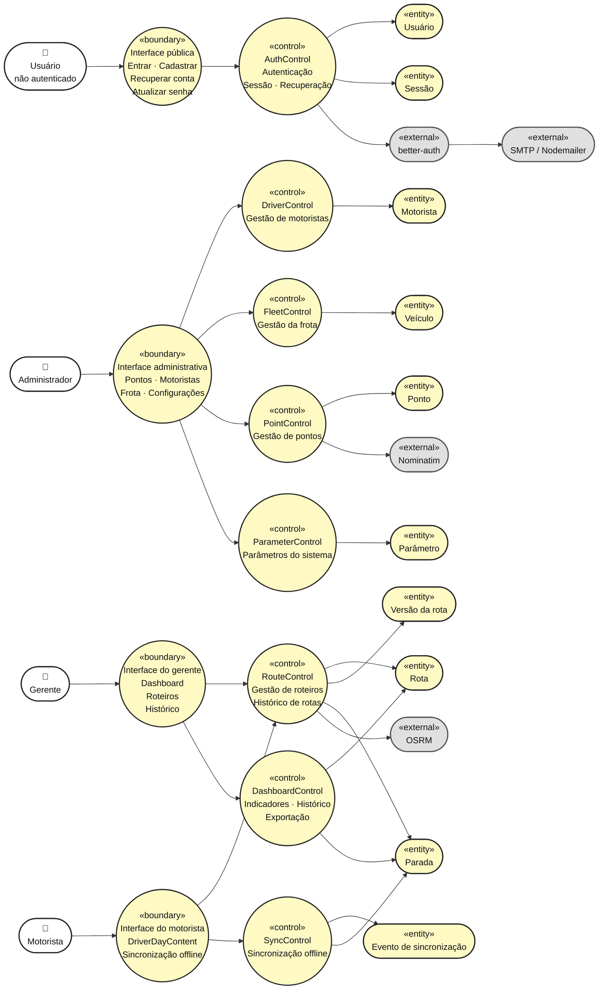
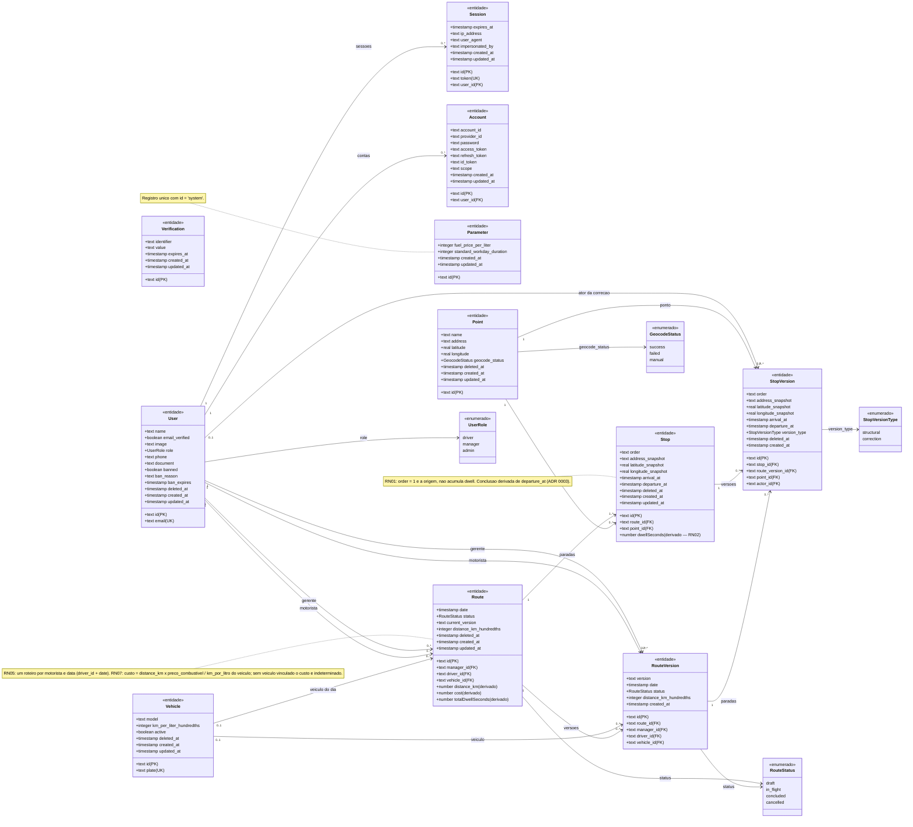

# Gerentregas — Diagramas

> Diagramas derivados da implementação do repositório: páginas e componentes em
> `src/app` e `src/components`, API tRPC em `src/server/api` e `src/server/modules/*`,
> esquema do banco em `src/server/db/schemas/*`.
>
> **Mapeamento dos requisitos:** os casos de uso referenciam os identificadores `RFxx`
> de [`docs/requisitos.md`](./requisitos.md); as entidades dos diagramas de robustez e de
> classes correspondem a [`docs/modelo-dados.md`](./modelo-dados.md).
>
> **Nota sobre notação:** o Mermaid não possui um tipo de diagrama UML nativo para casos
> de uso ou robustez; eles são representados por `flowchart` com o agrupamento e os esterótipos
> do UML preservados (ator, <<boundary>>, <<control>>, <<entity>>), e o diagrama de classes
> usa `classDiagram`.

---

## 1. Diagrama de Casos de Uso

Atores, casos de uso e associações conforme as procedures tRPC implementadas
(`auth`, `drivers`, `fleet`, `points`, `routes`, `dashboard`, `parameters`, `sync`) e as
telas correspondentes. A especialização representa o fato de que, no código, o perfil
`admin` atende a todas as procedures de `manager` (`roleMiddleware(["manager", "admin"])`).

```mermaid
flowchart LR

  %% =========================
  %% ATORES
  %% =========================

  A1["<div style='text-align:center'><pre>  o
 /|\
 / \</pre><b>Usuário<br/>não autenticado</b></div>"]

  A2["<div style='text-align:center'><pre>  o
 /|\
 / \</pre><b>Motorista /<br/>Motoboy</b></div>"]

  A3["<div style='text-align:center'><pre>  o
 /|\
 / \</pre><b>Gerente /<br/>Coordenador</b></div>"]

  A4["<div style='text-align:center'><pre>  o
 /|\
 / \</pre><b>Administrador</b></div>"]

  %% Generalização do Administrador
  A4 -. "especializa" .-> A3


  %% =========================
  %% FRONTEIRA DO SISTEMA
  %% =========================

  subgraph SISTEMA["SISTEMA DE GESTÃO DE ROTAS E ENTREGAS"]
    direction TB

    %% -------------------------
    %% CONTA E ACESSO
    %% -------------------------

    subgraph CONTA["Conta e acesso"]
      direction TB
      UC01(["Cadastrar-se"])
      UC02(["Autenticar-se"])
      UC03(["Encerrar sessão"])
      UC04(["Solicitar redefinição de senha"])
      UC05(["Redefinir senha com token"])
      UC06(["Consultar próprio perfil"])
      UC07(["Alterar tema da conta"])
    end


    %% -------------------------
    %% USUÁRIOS
    %% -------------------------

    subgraph USUARIOS["Gestão de usuários"]
      direction TB
      UC08(["Cadastrar motorista"])
      UC09(["Cadastrar gerente"])
      UC10(["Listar usuários"])
      UC11(["Consultar usuário"])
      UC12(["Atualizar dados do usuário"])
      UC13(["Excluir usuário"])
      UC14(["Restaurar usuário"])
    end


    %% -------------------------
    %% FROTA
    %% -------------------------

    subgraph FROTA["Gestão de veículos"]
      direction TB
      UC15(["Cadastrar veículo"])
      UC16(["Listar veículos"])
      UC17(["Editar veículo"])
      UC18(["Excluir veículo"])
    end


    %% -------------------------
    %% PONTOS
    %% -------------------------

    subgraph PONTOS["Gestão de pontos do roteiro"]
      direction TB
      UC19(["Cadastrar ponto"])
      UC20(["Consultar ponto"])
      UC21(["Listar pontos"])
      UC22(["Editar ponto"])
      UC23(["Excluir ponto"])
      UC24(["Restaurar ponto"])
      UC25(["Geocodificar endereço"])
    end


    %% -------------------------
    %% ROTEIROS
    %% -------------------------

    subgraph ROTEIROS["Gestão de roteiros"]
      direction TB
      UC26(["Montar roteiro do dia"])
      UC27(["Calcular distância do roteiro"])
      UC28(["Listar roteiros"])
      UC29(["Consultar roteiro"])
      UC30(["Editar roteiro"])
      UC31(["Gerar versão do roteiro"])
      UC32(["Adicionar parada"])
      UC33(["Editar parada"])
      UC34(["Concluir parada"])
      UC35(["Excluir parada"])
      UC36(["Excluir roteiro"])
      UC37(["Restaurar roteiro"])
      UC38(["Consultar histórico de versões"])
      UC39(["Corrigir horários da parada"])
    end


    %% -------------------------
    %% OPERAÇÃO
    %% -------------------------

    subgraph OPERACAO["Execução do roteiro"]
      direction TB
      UC40(["Consultar roteiro do dia"])
      UC41(["Iniciar turno"])
      UC42(["Escolher veículo"])
      UC43(["Registrar chegada"])
      UC44(["Registrar saída"])
      UC45(["Registrar tempo parado"])
      UC46(["Registrar chegada e saída offline"])
      UC47(["Sincronizar registros pendentes"])
      UC48(["Reprocessar registro rejeitado"])
      UC49(["Descartar registro rejeitado"])
    end


    %% -------------------------
    %% INDICADORES
    %% -------------------------

    subgraph INDICADORES["Dashboard e relatórios"]
      direction TB
      UC50(["Consultar dashboard diário"])
      UC51(["Consultar dashboard mensal"])
      UC52(["Consultar dashboard por período"])
      UC53(["Consultar detalhes de um dia"])
      UC54(["Exportar relatório CSV"])
      UC55(["Consultar jornada padrão"])
      UC56(["Consultar parâmetros"])
      UC57(["Atualizar parâmetros"])
    end


    %% =========================
    %% RELACIONAMENTOS INCLUDE
    %% =========================

    UC04 -. "«include»" .-> UC05

    UC19 -. "«include»" .-> UC25
    UC22 -. "«include»" .-> UC25

    UC26 -. "«include»" .-> UC27

    UC30 -. "«include»" .-> UC31

    UC32 -. "«include»" .-> UC27

    UC41 -. "«include»" .-> UC42

    UC44 -. "«include»" .-> UC45

    UC54 -. "«include»" .-> UC53


    %% =========================
    %% RELACIONAMENTOS EXTEND
    %% =========================

    UC46 -. "«extend»" .-> UC43
    UC46 -. "«extend»" .-> UC44

    UC47 -. "«extend»" .-> UC46

    UC48 -. "«extend»" .-> UC47
    UC49 -. "«extend»" .-> UC47

    UC39 -. "«extend»" .-> UC33
  end


  %% =========================
  %% ASSOCIAÇÕES DOS ATORES
  %% =========================

  %% Usuário não autenticado
  A1 --- UC01
  A1 --- UC02
  A1 --- UC04
  A1 --- UC05


  %% Motorista
  A2 --- UC03
  A2 --- UC06
  A2 --- UC07
  A2 --- UC16
  A2 --- UC40
  A2 --- UC41
  A2 --- UC43
  A2 --- UC44
  A2 --- UC46
  A2 --- UC47
  A2 --- UC48
  A2 --- UC49


  %% Gerente
  A3 --- UC03
  A3 --- UC06
  A3 --- UC07

  A3 --- UC08
  A3 --- UC10
  A3 --- UC11
  A3 --- UC12
  A3 --- UC13

  A3 --- UC15
  A3 --- UC16
  A3 --- UC17
  A3 --- UC18

  A3 --- UC19
  A3 --- UC20
  A3 --- UC21
  A3 --- UC22
  A3 --- UC23

  A3 --- UC26
  A3 --- UC28
  A3 --- UC29
  A3 --- UC30
  A3 --- UC32
  A3 --- UC33
  A3 --- UC34
  A3 --- UC35
  A3 --- UC36
  A3 --- UC38
  A3 --- UC39

  A3 --- UC50
  A3 --- UC51
  A3 --- UC52
  A3 --- UC53
  A3 --- UC54
  A3 --- UC55
  A3 --- UC56
  A3 --- UC57


  %% Administrador
  A4 --- UC09
  A4 --- UC14
  A4 --- UC24
  A4 --- UC37


  %% =========================
  %% ESTILOS
  %% =========================

  classDef ator fill:#ffffff,stroke:#3b5bdb,stroke-width:2px,color:#0b1a4a
  classDef uc fill:#ffffff,stroke:#495057,stroke-width:1.5px,color:#111111

  class A1,A2,A3,A4 ator
  class UC01,UC02,UC03,UC04,UC05,UC06,UC07,UC08,UC09,UC10,UC11,UC12,UC13,UC14,UC15,UC16,UC17,UC18,UC19,UC20,UC21,UC22,UC23,UC24,UC25,UC26,UC27,UC28,UC29,UC30,UC31,UC32,UC33,UC34,UC35,UC36,UC37,UC38,UC39,UC40,UC41,UC42,UC43,UC44,UC45,UC46,UC47,UC48,UC49,UC50,UC51,UC52,UC53,UC54,UC55,UC56,UC57 uc

```

### 1.1 Relações «include» / «extend» (e onde occurrem no código)

| Relação | Ocorrência no código |
| --- | --- |
| «include» RF25 → distância | `RoutesService.createRoute` chama `computeRouteDistance` |
| «include» RF29 → distância | `RoutesService.addStop` chama `recomputeRouteDistance` |
| «include» RF47 → drilldown | `DashboardRepository.exportCSV` executa `getDrilldown` |
| «extend» RF43 → registro offline | `DriverDayContent.handleCheckIn/handleCheckOut` desviam para `useSyncQueue` quando `isOnline === false` |
| «extend» RF44 → reprocessar rejeitado | `useSyncQueue.retry` / `dismiss` (delegando a `SyncClient`) operam sobre itens com `status = "rejected"` |
| «include» RF31 → registro de saída | `RoutesService.concludeStop` grava `departure_at` (equivalente ao check-out do motorista) |
| Especialização Administrador → Gerente | `managerMiddleware = roleMiddleware(["manager", "admin"])` |

---

## 2. Diagrama de Robustez

Mapeamento da arquitetura `routes/controllers/services/repositories` descrita em
`src/server/ARCHITECTURE.md` para um diagrama de robustez, organizando os elementos
segundo os estereótipos _actor_, _boundary_, _control_ e _entity_. As _boundaries_
representam as interfaces e telas do sistema; os _controls_ representam os routers
tRPC, controllers e services responsáveis pela coordenação das operações; e as
_entities_ representam os objetos de domínio, repositórios e dados persistidos.

Os atores interagem com as _boundaries_, que encaminham as solicitações aos
_controls_, e estes acessam ou manipulam as _entities_, evidenciando o fluxo
**ator → boundary → control → entity**.

---

## 3. Diagrama de Classes Conceitual

Entidades persistidas com seus atributos, cardinalidades e enumerados. Atributos marcados
como `derivado` são calculados na camada de serviço e não são gravados no banco.

### 3.1 Cardinalidades e regras refletidas no diagrama

| Cardinalidade | Regra de negócio / restrição |
| --- | --- |
| `User 1 ─ 0..* Route` (motorista) | RN05 — um roteiro por motorista e data, garantido pelo índice único `(driver_id, date)` |
| `Vehicle 0..1 ─ 0..* Route` | Vínculo opcional no cadastro; obrigatório a partir do início do turno; travado para a data quando a rota está `in_flight` |
| `Route 1 ─ 1..* Stop` | A criação exige ao menos a parada de origem (`stops.min(1)`) com ordem `1` |
| `Stop.route_id + order` | RN06 — ordem sequencial e única por roteiro |
| `Route 1 ─ 0..* RouteVersion` / `Stop 1 ─ 0..* StopVersion` | RNF06 — auditoria por versionamento a cada alteração estrutural ou correção |
| `Point 1 ─ 0..* Stop` | O ponto é reutilizável; a parada guarda *snapshot* de endereço e coordenadas |
| `Parameter 1 ─ 1` | Singleton `id = "system"`, consultado por rotas e dashboard (RN04/RN07) |

---

## 4. Consistência entre os documentos

| Elemento | `requisitos.md` | `modelo-dados.md` | `diagramas.md` |
| --- | --- | --- | --- |
| Roteiro, paradas e versões | RF24–RF35, RN05, RN06, RNF06 | `route`, `stop`, `route_version`, `stop_version` | Casos de uso UC25–UC37; Robustez `routesRouter → RoutesController → RoutesService → RoutesRepository`; Classes `Route`, `Stop`, `RouteVersion`, `StopVersion` |
| Tempo parado e conclusão | RF31, RF38, RF39, RF43–RF46, RN01–RN03 | `stop.arrival_at` / `stop.departure_at` (derivação de conclusão) | UC32/UC40/UC41; `Stop.dwellSeconds` e `Route.totalDwellSeconds` como atributos derivados |
| Frota e custo | RF14–RF17, RF28, RF37, RN07 | `vehicle.km_per_liter_hundredths`, `parameter.fuel_price_per_liter`, `route.distance_km_hundredths` | UC15–UC18, UC39; `Vehicle` e `Parameter` no diagrama de classes |
| Controle de acesso | RNF05, RF08–RF13, RF24–RF35, RF38–RF42 | `user.role`, `session`, `account` | Middleware por perfil no diagrama de robustez; generalização Administrador → Gerente |
| Auditoria e versões | RF34, RF35, RNF06 | `route_version`, `stop_version.version_type`, `stop_version.actor_id` | `current_version` no diagrama de classes e fluxo `createNewVersion` no service |
| Operação offline do motorista | RF40–RF42, RNF03, RNF04 | — (fila local no cliente) | `DriverDayContent`/`useSyncQueue` e `QueuedStopEvent` (IndexedDB) como *boundary/entity* local |
| LGPD | RNF07 | `user.document` cifrado, `deleted_at` | `DriversRepository.encrypt / maskDocument` no diagrama de robustez |
